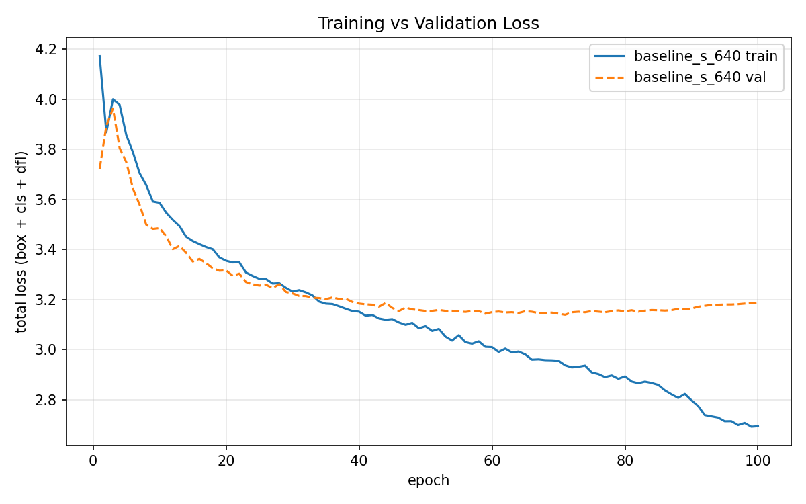
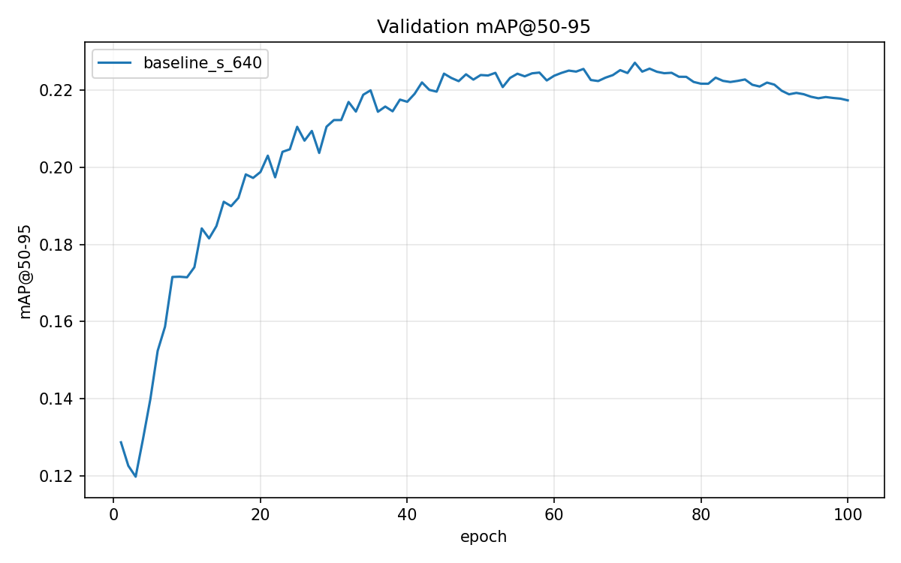
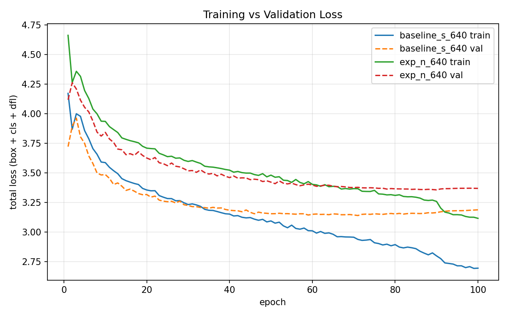
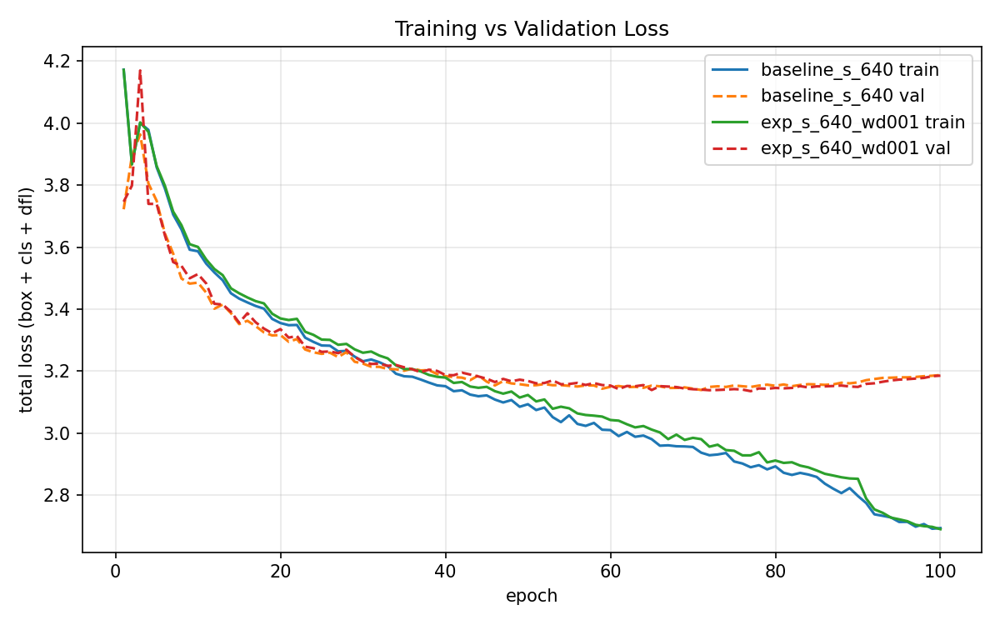
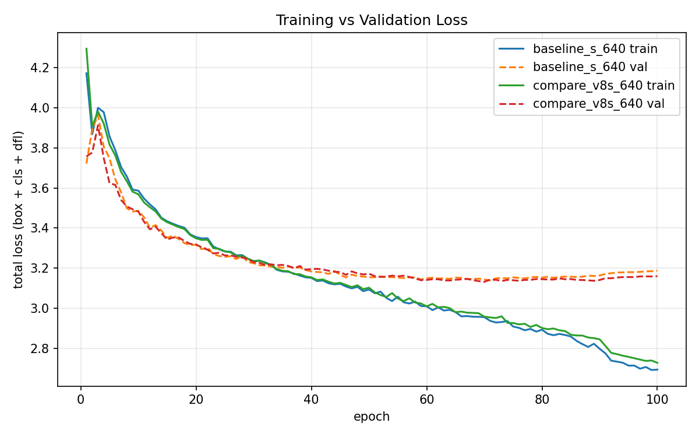

# Advanced Object Detection & Comparative Study using YOLOv11 — VisDrone

**CMPE 401 Instructor-defined Project 1**

Design, optimization, and comparative evaluation of modern YOLO models for
real-world object detection on the **VisDrone-DET** aerial dataset. This repo
contains a complete, reproducible pipeline: data download & conversion, baseline
training, loss/fitting analysis, controlled experiments, an iterative
improvement cycle, and an optional multi-version YOLO comparison.

> **Status:** complete. All required parts (I–IV) and the optional Part V are done.
> Full write-up in [`docs/REPORT.md`](docs/REPORT.md). Full write-up in [`docs/REPORT.md`](docs/REPORT.md).

---

## 1. Objective

Fine-tune a modern YOLO model (YOLOv11) on VisDrone-DET and study its training
dynamics rather than just its final score: diagnose overfitting/underfitting,
run controlled experiments, perform theory-driven improvements, and (optionally)
compare against other YOLO versions — all reproducibly.

## 2. Dataset — VisDrone-DET

Aerial images with dense, small objects across 10 classes: `pedestrian, people,
bicycle, car, van, truck, tricycle, awning-tricycle, bus, motor`. Splits: train
(~1.44 GB), val (~0.07 GB), test-dev (~0.28 GB), test-challenge (~0.28 GB).
Source: <https://github.com/VisDrone/VisDrone-Dataset>.

Raw VisDrone annotations (`x,y,w,h,score,category,trunc,occ`) are converted to
normalized YOLO boxes; category ids `1..10` map to YOLO classes `0..9`, and
`ignored regions (0)` / `others (11)` are dropped. See
[`scripts/convert_visdrone.py`](scripts/convert_visdrone.py).

## 3. Setup

```bash
python -m venv .venv
# Windows: .venv\Scripts\activate   |   Linux/Mac: source .venv/bin/activate
# Install a CUDA torch build first (Python 3.13 + RTX 3060 -> cu124):
pip install torch torchvision --index-url https://download.pytorch.org/whl/cu124
pip install -r requirements.txt
```

Verify the GPU is visible:

```bash
python -c "import torch; print(torch.cuda.is_available(), torch.cuda.get_device_name(0))"
```

## 4. Get the data

```bash
python scripts/download_visdrone.py --root datasets/VisDrone   # add --challenge for the competition split
python scripts/convert_visdrone.py --root datasets/VisDrone
python scripts/visualize_labels.py --split VisDrone2019-DET-train --n 6   # sanity check
```

## 5. Compute strategy (hybrid)

| Where | Use for | Typical config |
|---|---|---|
| **RTX 3060 laptop (6 GB)** | pipeline dev, light experiments (e.g. `yolo11n`) | imgsz 640, AMP |
| **Google Colab (T4/A100)** | baseline, large models, high-res, final/competition runs | `yolo11s` 640 batch 16 (baseline); `yolo11m` 1280 |

The same scripts run in both places. Colab workflow:
[`notebooks/colab_train.ipynb`](notebooks/colab_train.ipynb).

## 6. Reproduce the experiments

```bash
# Part I — baseline (run on a Colab T4 via notebooks/colab_train.ipynb, ~4.2 h)
python scripts/train.py --model yolo11s.pt --imgsz 640 --batch 16 --epochs 100 --name baseline_s_640

# Part II — loss / fitting analysis
python scripts/plot_curves.py results/runs/baseline_s_640

# Every experiment below runs on Colab via notebooks/colab_train.ipynb (edit the settings
# block in cell 4). Only the variable under test differs from the baseline.

# Part III — model capacity (n vs s); optional round 2: resolution 640 -> 960
python scripts/train.py --model yolo11n.pt --imgsz 640 --batch 16 --epochs 100 --name exp_n_640
python scripts/train.py --model yolo11s.pt --imgsz 960 --batch 16 --epochs 100 --name exp_s_960

# Part IV — cycle 1 (done): stronger L2 regularization
python scripts/train.py --model yolo11s.pt --imgsz 640 --batch 16 --epochs 100 --name exp_s_640_wd001     --extra weight_decay=0.001
# Part IV — cycle 2: keep mosaic augmentation on until the last epoch
python scripts/train.py --model yolo11s.pt --imgsz 640 --batch 16 --epochs 100 --name exp_s_640_closemosaic0     --extra close_mosaic=0

# Part V (optional) — multi-version comparison, matched recipe
python scripts/train.py --model yolov8s.pt --imgsz 640 --batch 16 --epochs 100 --name compare_v8s_640

# Evaluate any run on val / test-dev
python scripts/evaluate.py --weights results/runs/baseline_s_640/weights/best.pt --split test

# Build comparison table across runs
python scripts/summarize_runs.py results/runs/* --out results/tables/experiments.md
```

## 7. Repository layout

```
configs/visdrone.yaml        # dataset + class config for Ultralytics
scripts/
  download_visdrone.py       # fetch + extract VisDrone-DET
  convert_visdrone.py        # VisDrone annotations -> YOLO labels
  visualize_labels.py        # draw converted labels (sanity check)
  train.py                   # reproducible training wrapper (all experiments)
  evaluate.py                # val / test-dev metrics
  plot_curves.py             # train-vs-val loss + mAP curves (Part II)
  summarize_runs.py          # comparison tables (Parts III/IV/V)
notebooks/colab_train.ipynb  # heavy runs on Colab
results/                     # runs/ (gitignored), figures/, tables/
docs/REPORT.md               # graded technical write-up (Parts I–V)
```

## 8. Results

### Baseline (Part I)
`yolo11s`, imgsz 640, batch 16, 100 epochs, Colab T4. Metrics from `best.pt` (epoch 71).

| Split | mAP@50-95 | mAP@50 | Precision | Recall |
|---|---|---|---|---|
| val | 0.225 | 0.385 | 0.516 | 0.396 |
| test-dev | 0.186 | 0.327 | 0.463 | 0.352 |

### Loss curves (Part II)





### Controlled experiment (Part III): model capacity, yolo11n vs yolo11s
| Run | Params | GFLOPs | val mAP@50-95 | val mAP@50 | val P | val R | test mAP@50-95 | Inference (T4) |
|---|---|---|---|---|---|---|---|---|
| yolo11s (baseline) | 9.4M | 21.7 | 0.2247 | 0.3849 | 0.516 | 0.396 | 0.1863 | 7.8 ms |
| yolo11n | 2.6M | 6.6 | 0.1872 | 0.3304 | 0.453 | 0.351 | 0.1537 | 5.0 ms |



### Iterative improvement (Part IV, cycle 1): weight decay 0.0005 → 0.001
| Run | val mAP@50-95 | val mAP@50 | val P | val R | test mAP@50-95 | Train time (T4) |
|---|---|---|---|---|---|---|
| baseline_s_640 | 0.2247 | 0.3849 | 0.516 | 0.396 | 0.1863 | 4.16 h |
| exp_s_640_wd001 | 0.2276 | 0.3899 | 0.534 | 0.391 | 0.1854 | 4.35 h |



### Multi-version comparison (Part V): YOLO11s vs YOLOv8s, matched recipe
| Model | val mAP@50-95 | val mAP@50 | test mAP@50-95 | Params | GFLOPs | Train time (T4) | Inference (T4) |
|---|---|---|---|---|---|---|---|
| yolo11s | 0.2247 | 0.3849 | 0.1863 | 9.4M | 21.7 | 4.16 h | ~7 ms |
| yolov8s | 0.2291 | 0.3943 | 0.1839 | 11.1M | 28.7 | 3.92 h | ~7 ms |



### All runs
| Run | Part | Change vs baseline | val mAP@50-95 | test mAP@50-95 |
|---|---|---|---|---|
| baseline_s_640 | I | — | 0.2247 | 0.1863 |
| exp_n_640 | III | yolo11n | 0.1872 | 0.1537 |
| exp_s_640_wd001 | IV | weight_decay 0.001 | 0.2276 | 0.1854 |
| compare_v8s_640 | V | yolov8s | 0.2291 | 0.1839 |

Per-epoch validation at each run's best epoch, with training time:
[`results/tables/experiments.md`](results/tables/experiments.md).

## 9. Key findings
- **Baseline:** `yolo11s` at 640px reaches **0.225 mAP@50-95 on val** and **0.186 on test-dev**.
- **Mild overfitting after epoch ~71.** Train and val loss fall together until ~epoch 40;
  val loss then plateaus (~3.15), bottoms out at epoch 71 (also the best-mAP epoch), and
  rises slightly to 3.19 by epoch 100 while train loss keeps falling (3.09 → 2.69).
- **Mosaic shut-off widens the gap.** In the last 10 epochs (`close_mosaic=10`) train loss
  drops sharply but val loss does not follow — the easier, un-mosaiced images are fit, not
  generalized.
- **Capacity-limited on small objects.** ~85% of VisDrone boxes are smaller than 32×32 px
  at 640px input. Large, frequent classes do well (car 0.54 mAP@50-95) while small or rare
  ones lag (bicycle 0.06, awning-tricycle 0.09, people 0.12).
- **Accuracy is limited by model capacity, not dataset size.** yolo11n (−72% params) loses
  17% mAP@50-95 on both val and test-dev, underfits for most of training (its val loss stays
  below its train loss until ~epoch 60) and barely overfits. Small objects suffer most
  (bicycle −39%, pedestrian −24%) vs car −8%. It is 35% faster at inference but was not
  faster to train on Colab, where each epoch seems to be limited by CPU data loading.
- **Weight decay narrows the gap but doesn't raise accuracy.** Doubling it (0.0005 →
  0.001) keeps training loss ~0.03 higher at the same val loss during the mosaic phase
  (gap at epoch 90: 0.30 vs 0.37), but the effect disappears once mosaic switches off,
  and the best model is unchanged (val +0.003, test −0.001 — within seed noise).
  Overfitting is not the factor limiting accuracy; small-object underfitting is.
- **YOLO11 vs YOLOv8: same accuracy, better efficiency.** YOLOv8s is +0.004 on val
  but −0.002 on test-dev — a tie within seed noise — while needing 18% more parameters
  and 32% more FLOPs. Inference (~7 ms on a T4) and training time are about the same.
  Both models make the same mistakes: 34–41% of pedestrians, people and bicycles are
  missed entirely, and van is confused with car 41–43% of the time.
- **Overall:** accuracy on VisDrone is limited by capacity and input resolution for tiny
  objects, not by data size, regularization or YOLO generation. The most promising next
  step is higher input resolution (designed as `exp_s_960`, not run within the GPU budget).
- Full analysis (dataset size, model capacity, per-class results, confusion matrices,
  future work): [`docs/REPORT.md`](docs/REPORT.md).

## 10. Reproducibility notes
- All runs use `--seed` (default 0). Weights and `runs/` are gitignored; commit
  `results.csv`, figures, and tables, and document exact commands (above).
- Environment pinned in `requirements.txt`.
