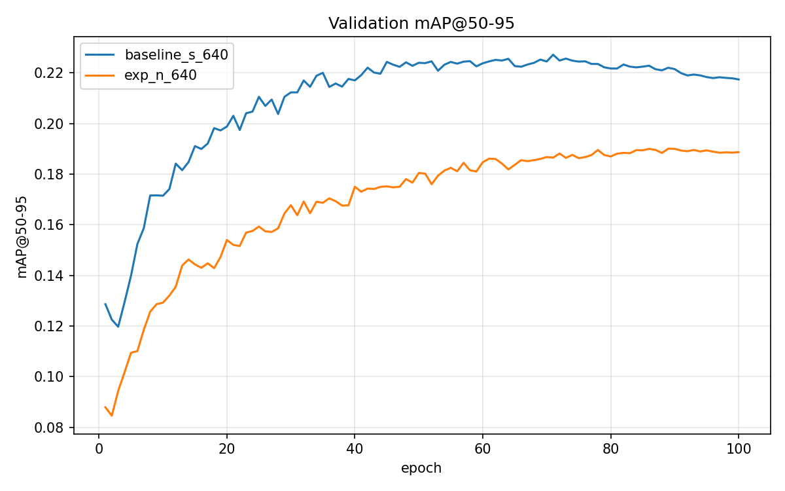
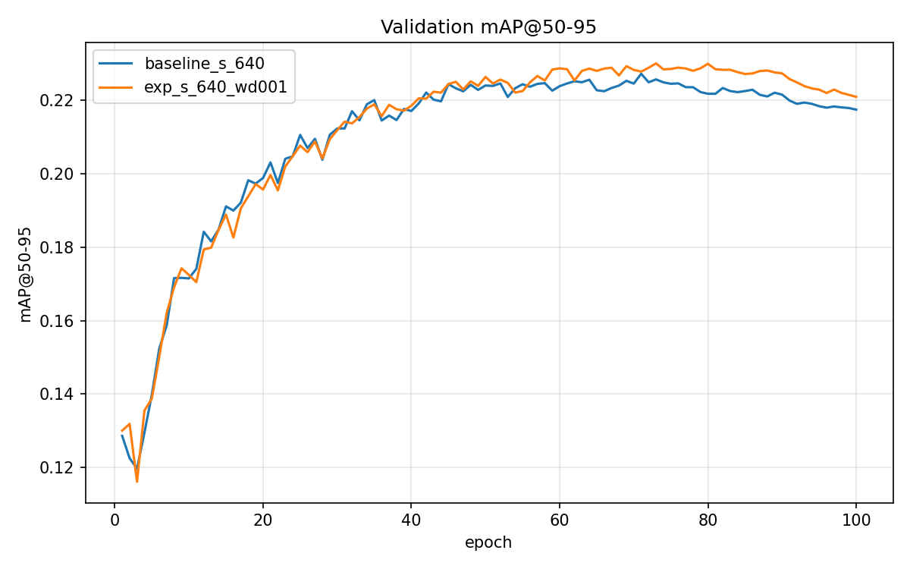
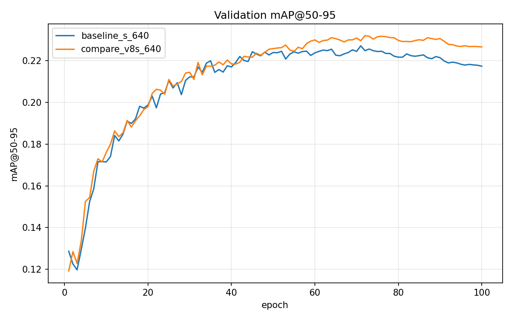

# CMPE 401 Project 1 — Technical Report

> All required parts (I–IV) and the optional Part V are complete. Two further
> experiments (Part III round 2, Part IV cycle 2) are designed but were not run within
> the GPU budget; see [Future work](#future-work-designed-not-run). Each
> section maps 1:1 to the required Parts in the project spec. Figures come from
> `results/figures/`, tables from `results/tables/`.

## 0. Overview
- **Team:** <name(s)>
- **Primary model:** YOLOv11 (`yolo11s`, 9.4M parameters, 21.7 GFLOPs at 640)
- **Dataset:** VisDrone-DET (10 classes)
- **Compute:** Google Colab T4 (baseline) + RTX 3060 laptop, 6 GB (pipeline dev, light runs)
- **Repo:** <https://github.com/eijikuinbii/CMPE401-YOLOv11>

### Dataset at a glance
Statistics of the converted YOLO labels (ignored regions and "others" removed):

| Split | Images | Boxes | Boxes / image | Boxes < 32×32 px at 640 input |
|---|---|---|---|---|
| train | 6,471 | 343,204 | 53.0 | 85.3% |
| val | 548 | 38,759 | 70.7 | 85.9% |

The median box covers only ~0.05% of the image (about 14×14 px at 640 input).
Classes are heavily imbalanced in train: car 144,866 and pedestrian 79,337 boxes
versus awning-tricycle 3,246, tricycle 4,812 and bus 5,926.

---

## Part I — Baseline Model
**Settings:** model=`yolo11s` (COCO-pretrained), imgsz=640, batch=16, epochs=100,
optimizer=auto (Ultralytics selected MuSGD, lr0=0.01, lrf=0.01, linear decay),
warmup=3 epochs, mosaic on with `close_mosaic=10`, AMP, seed=0. Trained on a Colab
T4 in three sessions (epochs 1–52, 53–86, 87–100) by resuming from `last.pt`;
the learning-rate schedule continues without a jump across resumes. Total
training time ≈ 4.2 h (~150 s/epoch).

Command:
```bash
python scripts/train.py --model yolo11s.pt --imgsz 640 --batch 16 --epochs 100 --name baseline_s_640
```

Results from `best.pt` (epoch 71), evaluated with `scripts/evaluate.py`:

| Split | mAP@50-95 | mAP@50 | Precision | Recall |
|---|---|---|---|---|
| val | 0.225 | 0.385 | 0.516 | 0.396 |
| test-dev | 0.186 | 0.327 | 0.463 | 0.352 |

(The per-epoch validation during training reports 0.227 mAP@50-95 at epoch 71; the
small difference comes from the standalone evaluation using a different batch size
and padding.)

Per-class mAP@50-95:

| Class | val | test-dev | train boxes |
|---|---|---|---|
| car | 0.544 | 0.456 | 144,866 |
| bus | 0.372 | 0.383 | 5,926 |
| van | 0.293 | 0.247 | 24,956 |
| truck | 0.238 | 0.252 | 12,875 |
| motor | 0.200 | 0.122 | 29,647 |
| pedestrian | 0.192 | 0.110 | 79,337 |
| tricycle | 0.152 | 0.104 | 4,812 |
| people | 0.117 | 0.046 | 27,059 |
| awning-tricycle | 0.085 | 0.105 | 3,246 |
| bicycle | 0.056 | 0.040 | 10,480 |

Inference speed on the T4: ~7.8 ms/img model forward pass (+ ~3 ms pre/post-processing).

Ultralytics' own plots for this run (PR curve, confusion matrix, prediction samples)
are in `results/runs/baseline_s_640/`, which is gitignored; reproduce with the command above.

---

## Part II — Loss Curve & Fitting Analysis


Total loss = box + cls + dfl.

| Epoch | Train loss | Val loss | Gap (val − train) | val mAP@50-95 |
|---|---|---|---|---|
| 1 | 4.172 | 3.722 | −0.450 | 0.129 |
| 40 | 3.152 | 3.184 | 0.032 | 0.217 |
| 71 (best) | 2.937 | **3.139** | 0.202 | **0.227** |
| 90 | 2.798 | 3.164 | 0.366 | 0.222 |
| 100 | 2.694 | 3.188 | 0.493 | 0.217 |

- **Convergence behavior:** In the first epochs, validation loss is *lower* than
  training loss because training images are heavily augmented (mosaic, HSV,
  scale/translate) while validation images are not. The bump at epoch 3 is the end
  of warmup, when the learning rate reaches its peak. From there both losses fall
  together until ~epoch 40. Validation loss then flattens around 3.15, and mAP is
  within 0.005 of its best from epoch 45 on. The model has essentially converged
  on the validation set by the midpoint of the 100-epoch schedule.
- **Overfitting?** Mild, late overfitting. Validation loss reaches its minimum at
  epoch 71 (3.139), which is also the epoch with the best mAP and the source of
  `best.pt`. After that, training loss keeps falling (2.94 → 2.69) while validation
  loss rises slightly (3.14 → 3.19), and the gap grows from 0.20 to 0.49. mAP drops
  only from 0.227 to 0.217, so the overfitting is real but small. The last 10 epochs
  make it clearer: with `close_mosaic=10`, mosaic augmentation is switched off, the
  training images become easier, and training loss drops sharply (2.80 → 2.69). Validation
  loss does not follow; it keeps rising. Without mosaic as a regularizer, the extra
  fit goes into the training set, not into generalization.
- **Underfitting?** Yes, in absolute terms. A validation loss that plateaus at ~3.15
  and a mAP@50-95 of 0.225 show the model cannot represent much of the task: recall
  is only 0.40, so most objects are missed. The fact that training loss keeps
  falling shows the model can still fit the training data. The ceiling is in what
  it can generalize at this resolution and size, not in optimization.
- **Causes — dataset size:** 6,471 training images is small for a 9.4M-parameter
  detector trained for 100 epochs: each image is seen 100 times, which is enough
  for the model to start memorizing image-specific details once the shared
  features are learned (~epoch 70). However, the dataset is dense (53 boxes per
  image, 343k boxes), so the *box* count is large; this is why overfitting stays
  mild rather than severe. The imbalance matters too: car (145k boxes) reaches
  0.54 mAP, while classes with few examples, like awning-tricycle (3.2k) and
  tricycle (4.8k), stay below 0.16. Pedestrian has 79k boxes but still reaches only
  0.19, so object size matters as much as the number of examples (next point).
- **Causes — model capacity:** 85% of boxes are smaller than 32×32 px at 640 input,
  and the median box is ~14×14 px. YOLO11's finest detection head works on a stride-8
  feature map, so a 14-px object covers only about 2×2 cells. `yolo11s` has
  limited width to encode such small, low-detail objects, and downscaling the
  original images (about 1360–2000 px wide) to 640 removes much of the detail before
  the network sees it. Large classes do well (car 0.54, bus 0.37); tiny or similar-looking
  classes do poorly: bicycle 0.06, and people 0.12, which is easily confused with
  pedestrian. This points to underfitting from limited capacity and resolution,
  with mild overfitting layered on top late in training.
- **Implications for the next experiments:**
  - The capacity/resolution limit suggests testing model size (n vs s vs m) and a
    higher `imgsz` (Part III).
  - The late overfitting suggests stronger regularization or keeping augmentation
    on longer (Part IV).

---

## Part III — Structured Experimental Design

### Round 1 — Model capacity (yolo11n vs yolo11s)

**Question.** Part II concluded the baseline is mainly *capacity/resolution-limited*
(underfitting on small objects), with mild late overfitting. Two hypotheses predict
different outcomes for a smaller model:
- **H1, capacity-limited:** a smaller model loses clear accuracy, most on small and
  rare classes, and underfits more.
- **H2, data-limited:** if the 6.5k-image dataset were the real limit, a smaller
  model would lose little accuracy and overfit less.

**Settings.** Only the model size changes: `yolo11n` (2.6M params, 6.6 GFLOPs) vs
`yolo11s` (9.4M params, 21.7 GFLOPs). Everything else is identical to the baseline:
imgsz 640, batch 16, 100 epochs, optimizer auto, seed 0, default augmentation with
`close_mosaic=10`, Colab T4. The yolo11n run was resumed once after a Colab
disconnect (epochs 1–53, then 54–100).

```bash
python scripts/train.py --model yolo11n.pt --imgsz 640 --batch 16 --epochs 100 --name exp_n_640
```

**Quantitative results** (`best.pt` of each run, standalone evaluation):

| Run | Model | Params (M) | GFLOPs | val mAP@50-95 | val mAP@50 | val P | val R | test mAP@50-95 | test mAP@50 | Inference (ms/img, T4) | Train time (T4) |
|---|---|---|---|---|---|---|---|---|---|---|---|
| baseline_s_640 | yolo11s | 9.4 | 21.7 | 0.2247 | 0.3849 | 0.516 | 0.396 | 0.1863 | 0.3265 | 7.8 | 4.16 h |
| exp_n_640 | yolo11n | 2.6 | 6.6 | 0.1872 | 0.3304 | 0.453 | 0.351 | 0.1537 | 0.2768 | 5.0 | 4.08 h |
| **Δ (n vs s)** | | −72% | −70% | **−0.038 (−17%)** | −0.055 | −0.062 | −0.045 | **−0.033 (−17%)** | −0.050 | −35% | −2% |




Training dynamics (total loss = box + cls + dfl):

| Epoch | Train loss (s / n) | Val loss (s / n) | Gap val − train (s / n) | val mAP@50-95 (s / n) |
|---|---|---|---|---|
| 20 | 3.355 / 3.709 | 3.317 / 3.626 | −0.039 / −0.083 | 0.199 / 0.154 |
| 40 | 3.152 / 3.523 | 3.184 / 3.460 | 0.032 / −0.063 | 0.217 / 0.175 |
| 60 | 3.010 / 3.403 | 3.150 / 3.397 | 0.140 / −0.006 | 0.224 / 0.185 |
| 80 | 2.893 / 3.309 | 3.153 / 3.365 | 0.260 / 0.056 | 0.222 / 0.187 |
| 90 | 2.798 / 3.258 | 3.164 / 3.356 | 0.366 / 0.098 | 0.222 / 0.190 |
| 100 | 2.694 / 3.115 | 3.188 / 3.369 | 0.493 / 0.253 | 0.217 / 0.189 |

| | yolo11s | yolo11n |
|---|---|---|
| Epoch of best val mAP | 71 | 89 |
| Epoch of lowest val loss | 71 (3.139) | 90 (3.356) |
| Val-loss rise after its minimum | +0.048 | +0.013 |

Per-class val mAP@50-95 (sorted by relative loss):

| Class | yolo11s | yolo11n | Δ | Relative |
|---|---|---|---|---|
| bicycle | 0.056 | 0.034 | −0.022 | −39% |
| pedestrian | 0.192 | 0.146 | −0.046 | −24% |
| motor | 0.200 | 0.152 | −0.048 | −24% |
| tricycle | 0.152 | 0.117 | −0.035 | −23% |
| people | 0.117 | 0.093 | −0.024 | −21% |
| truck | 0.238 | 0.190 | −0.048 | −20% |
| bus | 0.372 | 0.314 | −0.057 | −15% |
| van | 0.293 | 0.252 | −0.041 | −14% |
| awning-tricycle | 0.085 | 0.074 | −0.011 | −13% |
| car | 0.544 | 0.500 | −0.044 | −8% |

**Analysis.**
- **The data supports H1 (capacity-limited), not H2.** Cutting parameters by 72% costs
  17% mAP@50-95 on both val and test-dev, a drop of 0.033–0.038, far above the ~0.005
  that a different random seed could explain. If data were the main limit, the smaller
  model would have lost much less.
- **yolo11n underfits for most of training.** Its validation loss stays *below* its
  training loss until about epoch 60. Training images are heavily augmented, and a
  small model cannot fit them even as well as the clean validation images. Both losses
  stay well above yolo11s throughout (val 3.36 vs 3.14 at best). Its best epoch is 89,
  not 71: it is still improving when yolo11s has already started to overfit.
- **Overfitting scales with capacity.** yolo11s's train/val gap grows steadily after
  epoch 40. yolo11n's gap stays near zero until epoch 80, and validation loss rises
  only +0.013 after its minimum (vs +0.048). The larger model can memorize more of
  the 6.5k training images; the smaller one cannot. This is the classic
  bias–variance trade-off: less capacity means less variance (overfitting) but more
  bias (underfitting), and here the extra bias costs far more accuracy than the
  variance it saves.
- **yolo11n overfits only when mosaic switches off.** Most of its gap (0.098 → 0.253)
  appears in the last 10 epochs, after `close_mosaic=10`. This is the same pattern
  seen in Part IV cycle 1, and it independently supports cycle 2 (`close_mosaic=0`).
- **Small objects suffer most.** The largest relative losses are on small objects:
  bicycle −39%, pedestrian and motor −24%, people −21%. Car, the largest and most
  common class, loses only 8%. With fewer channels, the stride-8 feature map has less
  room to encode a ~14×14 px object, so detail-heavy small classes lose the most.
- **Efficiency trade-off.** yolo11n is 35% faster at inference (5.0 vs 7.8 ms/img on a
  T4) with 70% fewer FLOPs, but training was not faster (4.08 vs 4.16 h). On Colab,
  each epoch seems to be limited by loading and augmenting images on the CPU rather
  than by GPU compute, so a smaller network saves no training time on this hardware.

**Conclusion.** On VisDrone, accuracy is limited by model capacity, not by
dataset size. A smaller model underfits more and loses the most on small objects;
the benefit of less overfitting is far too small to make up for it. So the way to
improve accuracy is to add capacity or input resolution (round 2 below), rather
than more regularization (Part IV cycle 1).

### Round 2 (optional, not run) — Input resolution (640 vs 960)

> **Status:** designed but not run within the GPU budget; see Future work.

- **Question:** does giving the network more pixels per object (85% of boxes are
  < 32×32 px at 640) raise mAP, and by how much on small classes?
- **Controlled variable:** `imgsz` 640 → 960, `yolo11s`, everything else identical.
  Costs ~2.25× compute per epoch (~9–10 h on a T4).

| Run | Model | imgsz | val mAP@50-95 | val mAP@50 | P | R | test mAP@50-95 |
|---|---|---|---|---|---|---|---|
| baseline_s_640 | yolo11s | 640 | 0.225 | 0.385 | 0.516 | 0.396 | 0.186 |
| exp_s_960 | yolo11s | 960 | | | | | |

---

## Part IV — Iterative Model Improvement

### Cycle 1 — L2 regularization (weight decay 0.0005 → 0.001)

**1. Baseline.** `baseline_s_640` (Part I): val mAP@50-95 0.225, test-dev 0.186. Part II
found mild overfitting after epoch 71: validation loss rises from 3.139 to 3.188 while
training loss keeps falling, and the train/val gap grows from 0.20 to 0.49.

**2. Experimental settings.** Identical to the baseline: `yolo11s`, imgsz 640,
batch 16, 100 epochs, optimizer auto (MuSGD), lr0 0.01, seed 0, default augmentation
with `close_mosaic=10`, Colab T4.

**3. Controlled modification.** One change: `weight_decay` 0.0005 → 0.001.
- **Principle:** weight decay adds an L2 penalty λ‖w‖² to the loss, which pulls weights
  toward zero and limits how sharply the network can fit individual training images.
  Larger λ means a smoother, lower-capacity function and should reduce overfitting.
- **Effective strength:** Ultralytics scales weight decay by batch × accumulate / nbs
  = 16 × 4 / 64 = 1, so the effective λ really doubles.
- **Which weights:** it applies to conv weights (including MuSGD's Muon parameter
  group), not to biases or BatchNorm.

```bash
python scripts/train.py --model yolo11s.pt --imgsz 640 --batch 16 --epochs 100 \
    --name exp_s_640_wd001 --extra weight_decay=0.001
```

**4. Evaluation.** `best.pt` of each run, standalone evaluation:

| Run | Change | val mAP@50-95 | val mAP@50 | val P | val R | test mAP@50-95 | test mAP@50 | Train time |
|---|---|---|---|---|---|---|---|---|
| baseline_s_640 | — | 0.2247 | 0.3849 | 0.516 | 0.396 | 0.1863 | 0.3265 | 4.16 h |
| exp_s_640_wd001 | weight_decay 0.001 | 0.2276 | 0.3899 | 0.534 | 0.391 | 0.1854 | 0.3260 | 4.35 h |
| **Δ** | | **+0.003** | +0.005 | +0.019 | −0.005 | **−0.001** | −0.001 | |




Training dynamics (total loss = box + cls + dfl):

| Epoch | Train loss (base / wd) | Val loss (base / wd) | Gap (base / wd) | val mAP@50-95 (base / wd) |
|---|---|---|---|---|
| 40 | 3.152 / 3.179 | 3.184 / 3.188 | 0.032 / 0.008 | 0.217 / 0.218 |
| 60 | 3.010 / 3.043 | 3.150 / 3.154 | 0.140 / 0.111 | 0.224 / 0.229 |
| 73 | 2.931 / 2.963 | 3.151 / 3.139 | 0.220 / 0.177 | 0.226 / **0.230** |
| 90 | 2.798 / 2.853 | 3.164 / 3.149 | 0.366 / 0.296 | 0.222 / 0.227 |
| 100 | 2.694 / 2.691 | 3.188 / 3.186 | 0.493 / 0.495 | 0.217 / 0.221 |

Per-class val mAP@50-95 changed by at most ±0.015 (largest gain: bus +0.015;
largest drop: tricycle −0.007).

**5. Analysis.**
- **Weight decay did regularize while mosaic was on.** Over epochs 41–90, training
  loss is on average 0.031 higher than the baseline at the same validation loss, so
  the model fits the training set less tightly without generalizing worse. The gap at
  epoch 90 shrinks from 0.37 to 0.30, and late-training mAP holds up better: the best
  epoch moves from 71 to 73, and mAP at epoch 90 is 0.227 vs 0.222.
- **The benefit disappears when mosaic switches off.** In the last 10 epochs
  (`close_mosaic=10`), both runs drop to the same training loss (2.69) and gap (0.49).
  Removing mosaic makes the training images far easier, and that change dominates the
  small L2 penalty. The model then fits the training set equally tightly in both runs.
- **The best model barely changed.** Validation +0.003 and test-dev −0.001 are within
  what you would expect from a different random seed; we ran one seed per setting, so
  this cannot be separated from noise. Precision rose (+0.019) and recall fell
  (−0.005): the model became slightly more conservative, not better at finding objects.
- **Why there is no real gain:** the overfitting was mild and late; best.pt is chosen
  at the val-loss minimum anyway, so it already avoids most of it. The dominant
  problem is underfitting on tiny objects (Part II), which regularization cannot fix,
  because it limits capacity rather than adding it.

**6. Conclusion.** Doubling weight decay is a valid regularizer here: it measurably
narrows the train/val gap during the mosaic phase. But it does **not** improve the
final detector, because (a) its effect is erased once mosaic is switched off, and (b)
overfitting is not the factor limiting accuracy. This motivates two follow-ups:
cycle 2 (keep mosaic on until the end) and the Part III capacity/resolution
experiments, which target the real bottleneck. Part III round 1 has since confirmed
that accuracy is limited by model capacity: a smaller model loses 17% mAP.

### Cycle 2 (not run) — Keep mosaic augmentation to the end (`close_mosaic=0`)

> **Status:** designed but not run within the GPU budget; see Future work. Part V
> later confirmed the motivating pattern on a fourth run (YOLOv8s's gap also jumps
> from 0.30 to 0.43 in the last 10 epochs).

- **Baseline for comparison:** `baseline_s_640` (default `close_mosaic=10`).
- **Hypothesis (from cycle 1):** both runs overfit fastest in the final 10 epochs,
  exactly when mosaic is switched off. Mosaic acts as a strong data-level regularizer:
  it makes new compositions and scales for every batch. Keeping it on to the end should
  stop the late jump in the gap and keep validation loss from rising. The risk is that
  without a final "clean images" phase, the model is less tuned to un-mosaiced images,
  which is the format at test time.
- **Controlled modification:** `close_mosaic` 10 → 0. Everything else identical.
  ```bash
  python scripts/train.py --model yolo11s.pt --imgsz 640 --batch 16 --epochs 100 \
      --name exp_s_640_closemosaic0 --extra close_mosaic=0
  ```

| Run | Change | val mAP@50-95 | val mAP@50 | val P | val R | test mAP@50-95 | Gap @100 |
|---|---|---|---|---|---|---|---|
| baseline_s_640 | — | 0.2247 | 0.3849 | 0.516 | 0.396 | 0.1863 | 0.493 |
| exp_s_640_closemosaic0 | close_mosaic 0 | | | | | | |


---

## Part V — Multi-Version YOLO Comparison (optional)

### Settings
YOLOv11s vs YOLOv8s under a matched recipe: same size class ("s"), imgsz 640, batch 16,
100 epochs, optimizer auto (MuSGD for both), seed 0, default augmentation with
`close_mosaic=10`, Colab T4. Only the architecture differs. The YOLOv8s run was resumed
once after a Colab disconnect (epochs 1–51, then 52–100).

```bash
python scripts/train.py --model yolov8s.pt --imgsz 640 --batch 16 --epochs 100 --name compare_v8s_640
```

Params and GFLOPs (at 640, 10 classes) and inference time come from each run's
`metrics.json` (`scripts/evaluate.py`); training time from `scripts/summarize_runs.py`.

### Comparison table

| Model | val mAP@50-95 | val mAP@50 | val mAP@75 | val P | val R | test mAP@50-95 | test mAP@50 | Params (M) | GFLOPs | Train time (T4) | Inference (ms/img, T4, val / test) |
|---|---|---|---|---|---|---|---|---|---|---|---|
| **yolo11s** | 0.2247 | 0.3849 | 0.2234 | 0.516 | 0.396 | **0.1863** | **0.3265** | **9.4** | **21.7** | 4.16 h | 7.8 / 7.0 |
| **yolov8s** | **0.2291** | **0.3943** | **0.2272** | 0.519 | **0.409** | 0.1839 | 0.3244 | 11.1 | 28.7 | 3.92 h | 6.7 / 6.9 |
| Δ (v8s − 11s) | +0.004 | +0.009 | +0.004 | +0.004 | +0.012 | −0.002 | −0.002 | +18% | +32% | −6% | ≈ same |
| yolo11n (ref., Part III) | 0.1872 | 0.3304 | 0.1827 | 0.453 | 0.351 | 0.1537 | 0.2768 | 2.6 | 6.6 | 4.08 h | 5.0 / 4.2 |




Training dynamics:

| | yolo11s | yolov8s |
|---|---|---|
| Epoch of best val mAP | 71 (0.227) | 72 (0.232) |
| Epoch of lowest val loss | 71 (3.139) | 70 (3.132) |
| Val-loss rise after its minimum | +0.048 | +0.028 |
| Train/val gap at epoch 90 / 100 | 0.366 / 0.493 | 0.296 / 0.432 |
| Val mAP@50-95 at epoch 100 | 0.217 | 0.227 |

Per-class val mAP@50-95: differences are within ±0.011 for 9 of 10 classes; the
largest is bus (0.372 → 0.400, +0.028). On test-dev every class is within ±0.014.

### Confusion matrices (val, normalized by true class)

| Error type | yolo11s | yolov8s |
|---|---|---|
| people missed (predicted as background) | 0.40 | 0.40 |
| bicycle missed | 0.41 | 0.40 |
| pedestrian missed | 0.34 | 0.34 |
| van predicted as car | 0.41 | 0.43 |
| people predicted as pedestrian | 0.22 | 0.21 |
| bicycle predicted as motor | 0.20 | 0.20 |
| awning-tricycle predicted as tricycle | 0.21 | 0.16 |
| car correct | 0.70 | 0.71 |

Files: `results/runs/{baseline_s_640,compare_v8s_640}/eval_val/confusion_matrix_normalized.png`
(gitignored, reproduce with the commands above).

### Discussion
- **Accuracy: a tie.** YOLOv8s is +0.004 on val but −0.002 on test-dev. Both
  differences are within the ~0.005 that a different random seed could produce, and they
  point in opposite directions on the two splits, so neither model is more accurate
  on this task.
- **Efficiency: YOLO11 wins.** YOLO11s reaches the same accuracy with 15% fewer
  parameters (9.4M vs 11.1M) and 24% fewer FLOPs (21.7 vs 28.7 GFLOPs). This matches
  YOLO11's design goal: blocks like C3k2 and C2PSA get more out of each parameter than
  YOLOv8's C2f.
- **Speed: no measurable difference on a T4.** Inference is ~7 ms/img for both. Despite
  having fewer FLOPs, YOLO11s is not faster: at this size, GPU time depends more on
  memory access and the number of separate layer operations than on arithmetic, and
  YOLO11's attention block adds operations. The measurements also come from different
  Colab sessions, so ~1 ms differences are within timing noise. Training time is also the
  same (≈150 s/epoch), consistent with Part III's finding that training on Colab is
  limited by CPU data loading, not by the model.
- **Training dynamics:** both reach their best epoch at 70–72, but YOLOv8s's validation
  loss rises less afterwards (+0.028 vs +0.048) and its mAP stays flatter (0.227 vs 0.217
  at epoch 100). With one seed per model we cannot say whether this is an architectural
  property; in practice it does not matter, because `best.pt` is taken at the
  best epoch for both.
- **Both models make the same mistakes.** The confusion matrices are nearly identical.
  The dominant error is *missed detections*: 34–41% of pedestrians, people and bicycles
  are predicted as background. The main class confusions are between visually similar
  classes at aerial scale: van → car (41–43%), people → pedestrian (21–22%),
  bicycle → motor (20%), awning-tricycle → tricycle (16–21%). Because both architectures
  fail the same way, these errors come from the data (tiny objects, similar-looking
  classes seen from above), not from architecture choice.
- **Conclusion:** on VisDrone at 640px, moving between YOLO generations changes
  efficiency, not accuracy. The accuracy ceiling comes from small objects and input
  resolution (Parts II–III), which neither architecture addresses at this size and
  input resolution.

---

## Conclusion

| Run | Purpose | val mAP@50-95 | test mAP@50-95 | Outcome |
|---|---|---|---|---|
| baseline_s_640 | Part I baseline | 0.2247 | 0.1863 | reference |
| exp_n_640 | Part III: smaller model | 0.1872 | 0.1537 | −17%: capacity-limited |
| exp_s_640_wd001 | Part IV: 2× weight decay | 0.2276 | 0.1854 | gap narrows, accuracy unchanged |
| compare_v8s_640 | Part V: YOLOv8s | 0.2291 | 0.1839 | same accuracy, 24% more FLOPs |

1. **The task is limited by capacity and input resolution, not by data or regularization.**
   85% of objects are smaller than 32×32 px at 640 input. A smaller model loses 17% mAP,
   mostly on small classes, while stronger regularization and a different architecture
   leave accuracy unchanged.
2. **Overfitting is real but secondary.** It is mild, appears after ~epoch 70, is
   strongest once mosaic augmentation switches off, and `best.pt` already avoids it.
   Weight decay narrows the gap without improving the best model.
3. **YOLO11's advantage is efficiency.** It matches YOLOv8 accuracy with fewer parameters
   and FLOPs; on a T4 that does not translate into faster inference or training.
4. **Recommended model:** `yolo11s` at 640 (`baseline_s_640` or `exp_s_640_wd001`) for
   the best accuracy per FLOP; `yolo11n` when inference speed matters most.

## Future work (designed, not run)

These two experiments are fully specified and queued in the Colab notebook, but were
not run within the free-Colab GPU budget.

- **Part III round 2 — resolution 640 → 960** (`exp_s_960`, ~9–10 h on a T4). Every
  result above points to resolution as the most promising lever: it gives each tiny object
  more pixels on the stride-8 feature map. Expected to gain most on pedestrian, people and
  bicycle, the classes with the highest miss rates. This is also the candidate model for
  the optional VisDrone test-challenge.
- **Part IV cycle 2 — keep mosaic to the end** (`close_mosaic=0`, ~4.2 h). All four runs
  show their train/val gap widening fastest in the last 10 epochs, right after mosaic
  switches off. Keeping mosaic on should remove that jump; the open question is whether
  the model loses accuracy without a final phase on clean, un-mosaiced images.
- **Multiple seeds:** repeating key runs with 2–3 seeds would put error bars on the
  ±0.005 differences seen in Part IV and Part V.

---

## Reproducibility
- Exact commands for every run are in the README and in each section above.
- Every run uses `--seed 0`. Environment: `requirements.txt`.
- All Colab runs use `notebooks/colab_train.ipynb`; only its settings block changes
  between experiments.
- Re-evaluating the Colab-trained baseline `best.pt` on the local RTX 3060 gives the
  same val mAP@50-95 (0.2248 vs 0.2247).
- Limitation: one seed per configuration. Differences smaller than ~0.005 mAP should
  be treated as within run-to-run noise.
